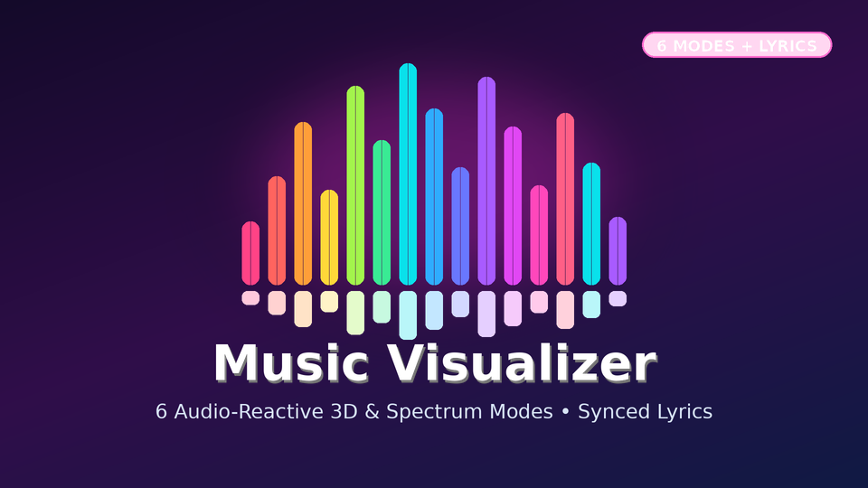

# Music Visualizer (Jellyfin.Plugin.MusicVisualizer)



Interactive fullscreen 6-mode audio visualizer with dynamic synchronized lyrics and artist backdrop slideshow for Jellyfin 12.4.

## Installation via Jellyfin Plugin Repository

Add the following repository URL in **Dashboard -> Plugins -> Repositories**:

```
https://raw.githubusercontent.com/koopjm/jellyfin-plugins/main/manifest.json
```
